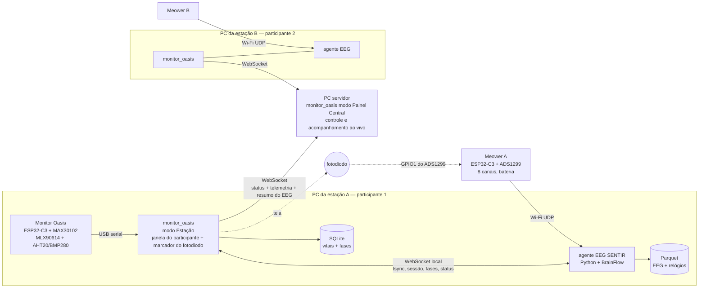

# 01 — Arquitetura do SENTIR

**SENTIR** — Sistema para Estudo Neurofisiológico da resposTa a Imagens e Reações.

O SENTIR **estende o [monitor_oasis](https://github.com/ilorivero/monitor_oasis)**. Esse app Flutter já apresenta as imagens OASIS (Open Affective Standardized Image Set), captura os sinais vitais por USB, grava em SQLite e tem os modos Estação e Painel Central. O SENTIR acrescenta o **EEG** (eletroencefalografia) da placa Meower, via BrainFlow, no mesmo eixo de tempo dos estímulos.

## Topologia (v0.2)

| Nó | Software | Grava? | Papel |
|---|---|---|---|
| **Estação** (1 por participante) | monitor_oasis (Estação) + agente EEG SENTIR | **sim, tudo, localmente** (SQLite + Parquet) | apresenta o protocolo, captura o Oasis (USB) e a Meower (Wi-Fi) |
| **Servidor** | monitor_oasis (Painel Central) | não (só ao vivo) | configura, inicia, pausa e para cada estação; mostra vitais e resumo do EEG em tempo real |
| **Meower** (1 por participante) | firmware Meower SENTIR | — | 8 canais de EEG (1 ADS1299; *footprint* do 2º pronto) + palavra de status (lead-off e fotodiodo) |
| **Monitor Oasis** | firmware Oasis SENTIR (compatível com o atual) | — | PPG (fotopletismografia) a 100 Hz, temperatura periférica, ambiente |

**Por que o EEG chega na estação, e não no servidor:**

1. "Armazenar primeiro em cada computador" vale para todos os dados.
2. Estímulo, vitais e EEG compartilham o relógio do mesmo PC — o elo de sincronização mais curto possível.
3. Uma falha de rede com o servidor não perde dados.

O servidor recebe o resumo e o traço reduzido ao vivo. Se preferir a Meower falando direto com o servidor, o agente roda igual lá (basta mudar `host`/`ip` na configuração), mas aí a sincronização com o estímulo passa a depender da rede entre os PCs.

## Componentes deste repositório

| Pasta | Conteúdo |
|---|---|
| `firmware/meower-sentir` | firmware da Meower (Arduino IDE **e** ESP-IDF): TSYNC, 8/16 canais, status no slot 16, ADS1299 emulado para testes |
| `firmware/oasis-sentir` | firmware do Monitor Oasis (Arduino IDE **e** ESP-IDF), compatível com o app, PPG a 100 Hz |
| `brainflow/` | driver `MeowerBoard` para o BrainFlow + script que o registra num checkout oficial |
| `backend/sentir` | **agente EEG** da estação (FastAPI + BrainFlow): Meower, relógios, gravação, WebSocket com o app |
| `integration/monitor_oasis` | patch para o monitor_oasis: cliente do agente, marcador do fotodiodo, EEG no Painel Central |
| `tools/` | simuladores (Meower e app monitor_oasis) e medidor de TSYNC |

## Rede

* Roteador **dedicado**, sem internet, 2,4 GHz em canal fixo (1, 6 ou 11), com IP fixo por reserva de DHCP (Dynamic Host Configuration Protocol) para cada Meower, estação e servidor.
* PCs **cabeados** ao roteador; só as Meower em Wi-Fi.
* Cada Meower manda dados para a **sua** estação: a placa adota o PC que envia `WOOF_WOOF` primeiro, e o agente usa o IP fixo da placa, então não há ambiguidade. As portas podem ser iguais (5000/5001) em todas as estações, porque cada uma tem IP próprio.
* O ESP32-C3 só opera em 2,4 GHz (802.11n). Wi-Fi 7 no roteador não melhora o C3; o ESP32-C5 (2,4/5 GHz) melhoraria. Driver e agente não mudam com o C5.
* Vazão: 8 canais a 1000 Hz ≈ 52 kB/s por placa (o pacote sempre leva os 16 slots).

## Fluxo de uma sessão

1. **Estação**: liga a Meower (bateria) e o Oasis (USB); inicia o **agente EEG** (`sentir-agent`) e o monitor_oasis. O agente conecta a Meower na hora — o sinal aparece no app e no Painel Central antes da sessão começar.
2. **Servidor**: no Painel Central, configura e inicia a estação (comando `configure_and_start`, que já existe).
3. **Estação**: validação dos sensores (já existe) → baseline. No primeiro onset confirmado, o app manda `session_start` ao agente, que abre `<dados>/<estação>/<participante>/<data-hora>/`.
4. Cada fase confirmada pelo `presentation_ack` vira uma mensagem `phase` para o agente, com o mesmo `start_timestamp` gravado no SQLite.
5. **Fim**: `session_stop`. O agente fecha os arquivos, refaz o ajuste de relógio com a sessão inteira e calcula a latência de tela pelo fotodiodo.
6. **Pós-coleta**: SQLite/CSV do monitor_oasis + Parquet do agente, ligados por `subject_code` e pelo eixo de tempo comum ([04-modelo-de-dados.md](04-modelo-de-dados.md)).
