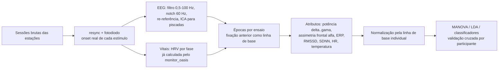

# 07 — Contrato com o pipeline de ML (etapa futura)

O pipeline de ML (*machine learning*, aprendizado de máquina) não faz parte da v0.2, mas os dados já são gravados pensando nele.

## Entrada garantida por participante/sessão

1. **monitor_oasis**: `<subject_code>_features.csv` (HRV — variabilidade da frequência cardíaca — por fase), `_timeseries.csv` (vitais), `_clock_sync.csv`; ou o SQLite direto.
2. **Agente EEG**: `session.json`, `eeg.parquet` (com coluna `t` após o `resync`), `events.parquet`, `clock_*.parquet`.
3. Ligação: `subject_code` + `exposure_id` (`events.trial`) + eixo de tempo comum ([04-modelo-de-dados.md](04-modelo-de-dados.md)).
4. Taxas nominais: EEG = `fs` (1000 Hz recomendado); PPG (fotopletismografia) a 100 Hz com o firmware SENTIR; temperatura a 4 Hz; ambiente a 0,5 Hz.

## Etapas previstas

ICA = análise de componentes independentes; ERP = potencial relacionado a evento; MANOVA = análise multivariada de variância; LDA = análise discriminante linear.

## Regras para não vazar informação

* Validação cruzada **por participante** (*leave-one-subject-out*).
* Normalização estimada só com a linha de base do próprio participante.
* Rótulos: normas OASIS (valência/alerta, já em `exposures`) ou autoavaliação; registrar qual foi usada.
* Excluir ensaios com `source = app_unsynced` ou sem borda de fotodiodo correspondente.
